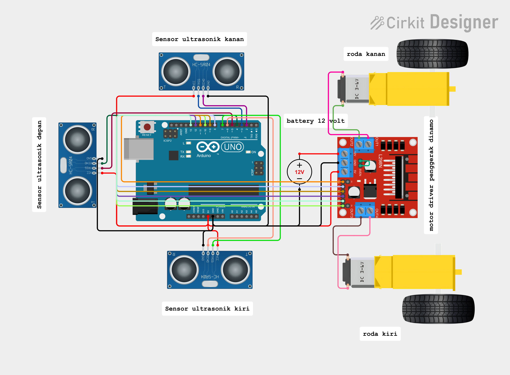

# Robot Wall Follower & Maze Solver

Proyek robot penelusur dinding (*Wall Follower*) dan pemecah labirin (*Maze Solver*) berbasis **Arduino UNO**, motor driver **L298N**, dan **3 buah sensor ultrasonik HC-SR04**.

Repository ini adalah pengembangan dan penyempurnaan khusus yang disesuaikan dengan dimensi lintasan lorong 40 cm dan bodi robot 16 cm.

---

## 🏆 Kredit & Sumber Kode Asli

Kode dasar dan algoritma navigasi repo ini diadaptasi dan dikembangkan dari proyek *open-source*:
- **Repositori Asli:** [buddhikadesilva/Wall-Maze-Solver-Robot](https://github.com/buddhikadesilva/Wall-Maze-Solver-Robot)
- **Pembuat Kode Asli:** [Buddhika De Silva](https://github.com/buddhikadesilva) / BevyLabs (dikembangkan untuk kompetisi SLIIT ROBOFEST).
- **Video Referensi Awal:** [YouTube Demo SLIIT Robofest](https://youtu.be/NCnxPN7vKUA)

---

## 🚀 Perubahan & Penyempurnaan pada Versi Ini

Dibandingkan dengan kode awal milik saya maupun referensi repo GitHub aslinya, versi ini menghadirkan perubahan dan optimasi besar berikut:

### 1. Perubahan Sudut Sensor (45° $\rightarrow$ 90° Tegak Lurus)
- **Versi Lama:** Sensor samping dipasang serong $45^\circ$ dan membutuhkan perhitungan trigonometri (`cos45`) serta offset untuk memperkirakan jarak dinding.
- **Versi Baru:** Sensor kiri dan kanan kini dipasang **$90^\circ$ tegak lurus** menghadap ke samping. Rumus trigonometri dihapus total, dan pembacaan ultrasonik samping langsung merefleksikan jarak horizontal riil ke dinding.

### 2. Penyesuaian Geometri Lorong 40 cm & Robot 16 cm
- **Jarak Ideal Tengah:** $\frac{40\text{ cm (lebar lorong)} - 16\text{ cm (lebar robot)}}{2} = 12\text{ cm}$.
- **Zona Toleransi Tengah:** $11.0\text{ cm} - 13.0\text{ cm}$ (robot meluncur lurus).
- **Ambang Terlalu Dekat:** $< 11.0\text{ cm}$ (koreksi halus menjauhi dinding).
- **Ambang Menjauh:** $13.0\text{ cm} - 22.0\text{ cm}$ (koreksi halus mendekati dinding).
- **Ambang Batas Celah / Simpangan:** $> 22.0\text{ cm}$ (deteksi dinding hilang / lorong terbuka).
- **Jarak Henti Depan (`DEPAN_STOP`):** Disesuaikan ke **$15.0\text{ cm}$** agar robot memiliki ruang pengereman inersia yang aman sebelum menyentuh dinding depan.

### 3. Navigasi Tanpa Rotary Encoder Fisik
- Repo asli GitHub menggunakan interupsi *rotary encoder* pada pin 2 (`encoderWrite()`).
- Pada robot ini, pin 2 digunakan untuk `ECHO_KANAN`. Sebagai gantinya, logika putar diubah menjadi **putaran berbasis waktu terkalibrasi (*Timed Pivot*)** (`TURN_90_MS` & `TURN_180_MS`) yang dilengkapi rem aktif (*active brake*) dan rutinitas proteksi sudut (*clear turn*) agar tidak terpicu halangan palsu pasca belok.

### 4. Penyesuaian Kecepatan & *Smoothing PWM*
- Kecepatan motor diturunkan 40% (berjalan di kisaran **60% PWM**) agar pembacaan gelombang pantul sensor HC-SR04 stabil dan tidak terlambat mengerem.
- Selisih PWM koreksi samping diperhalus (selisih kecil ~15 PWM) agar robot tidak mengalami *fishtailing* (bergoyang / zigzag) saat melaju di lorong sempit.
- Timeout `pulseIn` pada sensor dipersingkat dari $18.000\ \mu\text{s}$ menjadi **$8.000\ \mu\text{s}$** sehingga frekuensi pembacaan loop naik 2x lebih responsif.

### 5. Fitur Trim Motor (`TRIM_KIRI` & `TRIM_KANAN`)
- Menyeimbangkan ketidakseragaman RPM bawaan motor DC gearbox secara digital langsung melalui kode pemrograman.

### 6. Mode Kalibrasi Bawaan & File Uji Mandiri
Tersedia pemilih `MODE_OPERASI` di dalam file utama maupun sketch terpisah:
- `MODE 0`: Mode Operasi Normal (Maze Solver)
- `MODE 1` / [`Test_Sensor.ino`](Test_Sensor.ino): Tes pembacaan sensor ultrasonik real-time di Serial Monitor.
- `MODE 2` / [`Test_Motor.ino`](Test_Motor.ino): Tes kalibrasi belok 90° dan putar balik 180°.
- `MODE 3`: Tes kelurusan maju lurus motor tanpa sensor.

---

## 🔌 Skema & Gambar Rangkaian (Wiring Diagram)



Skema perkabelan dan visualisasi rangkaian elektronik interaktif lengkap dapat dilihat langsung melalui tautan proyek Cirkit Designer berikut:

🔗 **[Buka Skema Rangkaian Interaktif di Cirkit Designer](https://app.cirkitdesigner.com/project/30397120-9bb1-4c82-b9bd-54b2176aca74)**

> 💡 *Klik tautan di atas untuk melihat diagram perkabelan interaktif, tata letak breadboard/komponen, jalur Arduino UNO, Driver L298N, dan 3x Sensor Ultrasonik HC-SR04.*

---

## 📌 Konfigurasi Pin Hardware (Arduino UNO)

### Driver Motor L298N:
| Pin Arduino | Fungsi L298N | Keterangan |
| :---: | :---: | :--- |
| **Pin 11** | ENA | PWM Kecepatan Motor Kiri |
| **Pin 8** | IN1 | Arah Putar Motor Kiri |
| **Pin 9** | IN2 | Arah Putar Motor Kiri |
| **Pin 10** | ENB | PWM Kecepatan Motor Kanan |
| **Pin 12** | IN3 | Arah Putar Motor Kanan |
| **Pin 13** | IN4 | Arah Putar Motor Kanan |

### Sensor Ultrasonik HC-SR04:
| Posisi Sensor | Trigger Pin | Echo Pin |
| :--- | :---: | :---: |
| **Sensor Kanan (90°)** | Pin 3 | Pin 2 |
| **Sensor Depan** | Pin 5 | Pin 4 |
| **Sensor Kiri (90°)** | Pin 7 | Pin 6 |

---

## 🎥 Hasil Pengujian & Simulasi

Pengujian simulasi komputer telah dilakukan pada denah arena berukuran $4.0\text{ m} \times 2.0\text{ m}$ (10 kolom x 5 baris sel 40 cm). Robot berhasil memecahkan labirin dari **Start 1** hingga menembus garis **Finish 1** dalam waktu **76.43 detik**.

Video simulasi lengkap dapat dilihat di folder `test/`:
- [simulasi_maze_wall_follower.mp4](test/simulasi_maze_wall_follower.mp4)

---

## 📂 Struktur File

```
├── wall_follower_v2.ino          # Program utama Wall Maze Solver
├── wall_follower_v2 (1).ino      # File kerja utama
├── Test_Sensor.ino               # Sketch mandiri tes pembacaan sensor ultrasonik
├── Test_Motor.ino                # Sketch mandiri tes gerakan dan kalibrasi belok
├── README.md                     # Dokumentasi proyek
├── WallMazeSolver/               # Sumber kode referensi repo GitHub
├── Maze Robot Algorithm/         # Algoritma & tes motor referensi
└── test/                         # Arena Webots, skrip simulasi Python & video hasil uji
```
